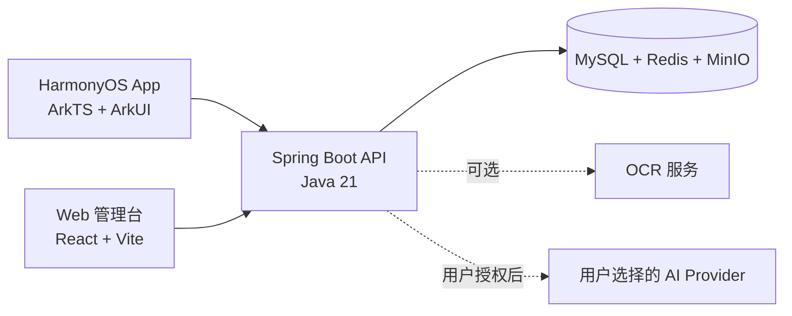

<div align="center">
  <a href="https://github.com/3128698033/harmony-ocr">
    
  </a>
  <h1>Harmony OCR</h1>
  <p><strong>面向 HarmonyOS 的图片文字识别、文本整理与云端历史管理产品。</strong></p>
  <p>从拍照识别到可编辑文本、可搜索历史，再到按用户授权启用的 AI 增强能力。</p>
  <p>
    <a href="https://github.com/3128698033/harmony-ocr/actions/workflows/ci.yml"></a>
    &nbsp;
    <a href="LICENSE">MIT License</a>
    &nbsp;
    <a href="CONTRIBUTING.md">参与贡献</a>
    &nbsp;
    <a href="SECURITY.md">安全报告</a>
  </p>
</div>

> [!NOTE]
> 这是 Harmony OCR 的首个公共源码快照，面向公开协作、学习和持续维护。仓库不包含生产密钥、签名材料、证书或第三方服务凭据。

<p align="center">
  <a href="#核心能力">核心能力</a> ·
  <a href="#系统架构">系统架构</a> ·
  <a href="#快速开始">快速开始</a> ·
  <a href="#本地开发">本地开发</a> ·
  <a href="#验证">验证</a> ·
  <a href="#安全与隐私">安全与隐私</a> ·
  <a href="#文档与贡献">文档与贡献</a>
</p>

## 核心能力

| 从图片到文字 | 从文字到资料 | 面向维护与扩展 |
| --- | --- | --- |
| 拍照、相册导入、预览、裁剪与 OCR | 编辑、复制、格式清理、收藏、搜索与导出 | Spring Boot API、React 管理台与 Docker 部署模板 |
| 扫描型 PDF 与批量 OCR 的服务端处理接口 | 云端历史同步、历史详情、删除与账号数据删除 | MySQL、Redis、MinIO、Nginx 与可选 OCR 服务 |
| HarmonyOS 端侧 OCR，必要时可调用后端 Provider | 用户主动授权后的 BYOK 纠错、摘要、翻译、排版与 Markdown 转换 | 用户资源隔离、JWT 认证、文件校验、密钥加密与安全检查 |

<details>
<summary><strong>技术栈</strong></summary>

| 层级 | 技术 |
| --- | --- |
| 移动端 | HarmonyOS, ArkTS, ArkUI |
| 服务端 | Java 21, Spring Boot 3 |
| 管理台 | React, Vite |
| 数据与存储 | MySQL, Redis, MinIO |
| 交付 | Docker Compose, Nginx, HTTPS |
| 认证 | JWT Access Token + Refresh Token |
</details>

## 系统架构



| 目录 | 内容 |
| --- | --- |
| [`app/`](app/) | HarmonyOS ArkTS + ArkUI 客户端 |
| [`server/`](server/) | Java 21 + Spring Boot 3 服务端与自动化测试 |
| [`admin-console/`](admin-console/) | React + Vite Web 管理台源码 |
| [`deploy/`](deploy/) | 本地与生产部署模板 |
| [`docs/`](docs/) | 产品、需求、架构、API、测试与部署文档 |
| [`scripts/`](scripts/) | 构建、验证和运维辅助脚本 |

## 快速开始

### 1. 获取源码

```powershell
git clone https://github.com/3128698033/harmony-ocr.git
Set-Location harmony-ocr
```

### 2. 选择要运行的模块

| 目标 | 入口 |
| --- | --- |
| 启动后端依赖与 API | [服务端开发](#启动依赖与服务端) |
| 启动 Web 管理台 | [管理台开发](#管理台) |
| 构建 HarmonyOS HAP | [HarmonyOS 客户端](#harmonyos-客户端) |
| 查看完整环境与部署要求 | [部署文档](docs/08-deployment.md) |

### 环境基线

| 模块 | 要求 |
| --- | --- |
| 服务端 | JDK 21、Apache Maven 3.9.x |
| 管理台 | Node.js 22.x、npm 10.x |
| HarmonyOS | Windows、DevEco Studio 6.0.2.640、HarmonyOS SDK `5.0.0(12)`，以及 DevEco 配套的 OHPM 与 Hvigor |
| 本地依赖 | Docker Engine 或 Docker Desktop，支持 Docker Compose v2 |
| 辅助脚本 | PowerShell 7 或 Windows PowerShell 5.1 |

> [!TIP]
> HarmonyOS HAP 构建依赖本地 DevEco SDK。标准 GitHub 托管运行器不提供该工具链，因此涉及移动端的变更需要在本地完成 HAP 构建验证。

## 本地开发

### 启动依赖与服务端

复制本地环境模板，并只在本机填写数据库和 MinIO 凭据：

```powershell
Copy-Item deploy/.env.example deploy/.env
./scripts/dev-compose-up.ps1
```

启动服务端前，在当前进程中设置与本地容器一致的 `DB_PASSWORD`、`MINIO_ACCESS_KEY`、`MINIO_SECRET_KEY`，并设置至少 32 个字符的随机 `JWT_SECRET`。然后运行：

```powershell
mvn -f server/pom.xml "-Dspring-boot.run.profiles=dev" spring-boot:run
```

停止本地依赖：

```powershell
./scripts/dev-compose-down.ps1
```

### 管理台

```powershell
npm --prefix admin-console ci --registry=https://registry.npmjs.org
npm --prefix admin-console run dev
```

生产构建会把固定名称的资源写入 `server/src/main/resources/static/admin/`：

```powershell
npm --prefix admin-console run typecheck
npm --prefix admin-console run build
```

### HarmonyOS 客户端

在 DevEco Studio 终端中运行：

```powershell
Push-Location app
try {
  ohpm install
  hvigorw.bat --mode module -p module=entry@default --no-daemon assembleHap
} finally {
  Pop-Location
}
```

仓库不提供应用签名配置。生成可安装或发布的 HAP 前，维护者需要自行配置合法的签名材料。

## 验证

按变更范围运行相应检查。测试数据、Issue 附件和复现材料只能使用合成或已脱敏数据。

```powershell
# 服务端测试
mvn -f server/pom.xml -B --no-transfer-progress test

# 管理台依赖、类型检查与构建
npm --prefix admin-console ci --registry=https://registry.npmjs.org
npm --prefix admin-console run typecheck
npm --prefix admin-console run build

# 公开仓库策略与管理台生成资产检查
./scripts/verify-public-repository.ps1 -RepositoryRoot $PWD -VerifyGeneratedAdminAssets
```

HarmonyOS 变更还必须运行上一节的 `ohpm install` 与 HAP 构建命令。提交前建议额外运行：

```powershell
git diff --check
```

## 安全与隐私

> [!IMPORTANT]
> 图片、OCR 文本、导出内容、账号数据与设备信息可能包含个人信息。部署者必须自行落实合法处理依据、保留期限、访问控制、删除流程和日志脱敏策略。

- 不要提交 `.env`、API Key、Token、证书、私钥、签名材料或真实 OCR 数据。
- 云端流程可能将用户选择的文件或 OCR 数据发送到配置的服务端，并保存到数据库或对象存储；默认开发配置不应用于真实敏感数据。
- AI 功能仅应在用户明确同意并主动触发后，把相关 OCR 文本发送至其选择的第三方 Provider；第三方隐私政策、数据保留和使用条款独立适用。
- 服务端 BYOK 配置仅保存 API Key 密文，并只返回掩码或指纹。没有安全的密钥管理、HTTPS 与访问控制时，不得启用真实 Provider。
- 自定义 Base URL 会扩大网络与数据外发风险。生产部署必须保留 SSRF 防护、HTTPS 限制、超时、域名审查和最小化传输策略。
- 仓库不附带 OCR 模型或商业 API 配额，也不保证第三方服务的可用性、准确率或合规性。

发现安全问题请遵循 [SECURITY.md](SECURITY.md) 使用 GitHub 私密漏洞报告渠道，不要在公开 Issue 中披露漏洞、凭据或个人数据。

## 文档与贡献

| 目的 | 文档 |
| --- | --- |
| 了解产品范围 | [产品概览](docs/00-product-overview.md) · [PRD](docs/01-prd.md) · [SRS](docs/02-srs.md) |
| 理解系统设计 | [架构](docs/03-architecture.md) · [API](docs/05-api-design.md) · [数据模型](docs/04-database-design.md) |
| 部署与验证 | [部署说明](docs/08-deployment.md) · [测试说明](docs/07-test-plan.md) |
| 参与协作 | [贡献指南](CONTRIBUTING.md) · [行为准则](CODE_OF_CONDUCT.md) · [变更日志](CHANGELOG.md) |

提交 Bug 或建议前，请先搜索现有 Issue，并确保不包含真实 OCR 原文、图片、账号信息或任何凭据。功能范围以 [PRD](docs/01-prd.md) 与 [SRS](docs/02-srs.md) 为准；超出范围的提议请先通过 Issue 讨论并同步文档。

## 许可证

本项目原创源码以 [MIT License](LICENSE) 发布，Copyright (c) 2026 Harmony OCR contributors。

MIT 许可证不改变第三方依赖、容器镜像、HarmonyOS SDK 或非代码资产原有的许可条款。相关边界见 [第三方通知](THIRD_PARTY_NOTICES.md) 与 [资产许可证](ASSET_LICENSES.md)。使用者应自行确认其分发和部署场景满足所有适用条款。
